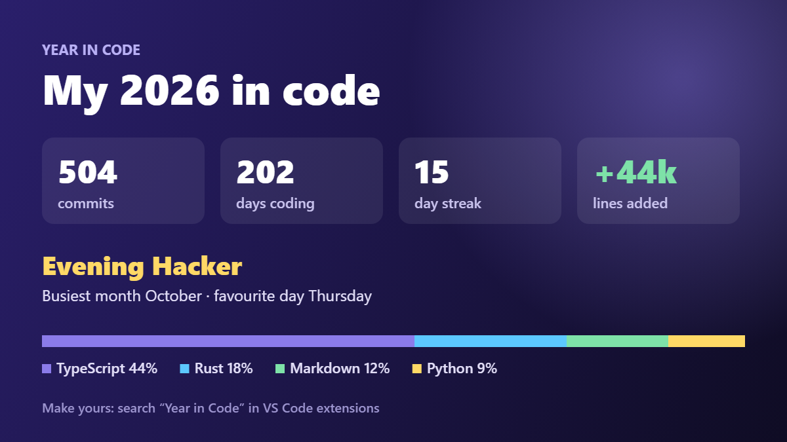
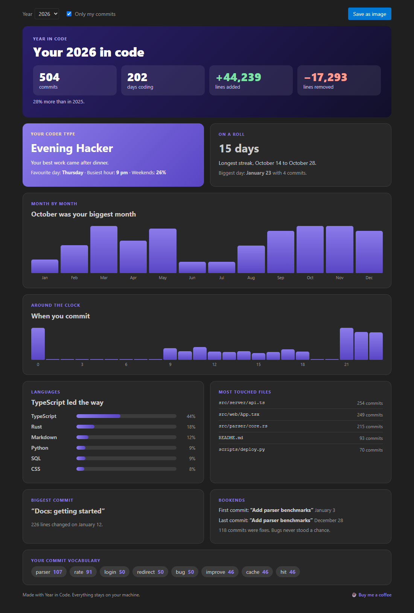

# Year in Code

**Your coding year, wrapped.** Commits, streaks, languages, your busiest hours and what kind of coder you are, built from your local git history inside VS Code. Save it as an image and share it.

No account. No GitHub token. Works with private repos, GitLab, Bitbucket and repos that never left your laptop. Nothing leaves your machine.

[](https://buymeacoffee.com/mehmeteminf)


## How to use

1. Open a folder that is a git repository (or a multi-root workspace with several).
2. Command Palette (<kbd>Ctrl</kbd>+<kbd>Shift</kbd>+<kbd>P</kbd>) → **Year in Code: Show My Year in Code**.
3. Pick a year, then **Save as image** to get a 1200×675 card for X, LinkedIn or Reddit.

## What's in your recap

- **Commits, days coding, lines added and removed**, and how it compares with last year
- **Your coder type:** Early Bird, Daylight Dev, Evening Hacker or Night Owl
- **Longest streak** of days in a row with commits, and your biggest day
- **Month by month** and **around the clock** charts
- **Top languages** by lines changed
- **Most touched files**, your **biggest commit**, your **first and last commit** of the year
- **Your commit vocabulary:** the words you use most in commit messages
- **A share card** (1200×675 PNG) for X, LinkedIn or Reddit:





## Details

- Counts commits on all branches, without merge commits, by their author date in your own time zone.
- **Only my commits** uses your `git config user.email`. If you committed with other emails (work laptop, GitHub noreply), add them in Settings → `yearInCode.authorEmails`.
- Lock files, `dist/`, `build/`, `vendor/`, `node_modules/` and minified files are left out of line counts, so a `package-lock.json` update doesn't look like your biggest commit.
- In January it opens last year's recap by default.

## Development

```bash
npm install
npm test               # parser and stats unit tests, including a real temporary git repo
npm run test:vscode    # downloads VS Code and runs the extension inside it
node scripts/preview.js [repoPath] [year]   # renders the panel and share card to images/
npm run package        # builds the .vsix
```

## Support

Year in Code is free and open source. If your recap made you smile, [buy me a coffee](https://buymeacoffee.com/mehmeteminf) ☕. Bugs and ideas: [Issues](https://github.com/mehmeteminakkaya/year-in-code/issues).

## License

MIT
